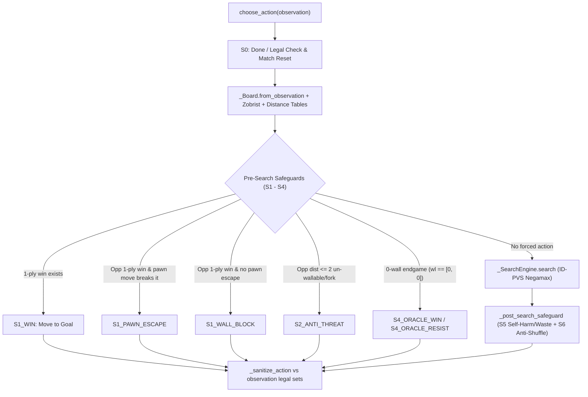

# Optimized Rule-Based Wrongway Agent (`optimized_bot.py`)

Documentation of the full rule-based agent implemented in [optimized_bot.py](file:///C:/Users/84775/Desktop/CryptoGraphy/wrongway-CS420/submissions/optimized_bot.py) (`1,911` lines, pure Python 3.9+ standard library, **no MLP / neural network weights**).

---

## 1. Design Goals & Provenance

[`optimized_bot.py`](file:///C:/Users/84775/Desktop/CryptoGraphy/wrongway-CS420/submissions/optimized_bot.py) synthesizes the highest-leverage mechanisms across three bot families in this repository while intentionally dropping `quoridors_ace_brfast.py`'s neural MLP (`_WEIGHTS_B85`, `_unpack_net`, `_net_cp`, `wcache`, `seal_cache`):

| Source Family | Adopted Components | Modifications / Improvements |
| :--- | :--- | :--- |
| **`quoridors_ace_brfast` & `quoridors_expert`** | 81-bit bitboard representation, witness & shortest-path DAG cut masks, wall templates (`HW_TPL_*`, `VW_TPL_*`), Zobrist hashing, 0-wall retrograde BFS oracle, PVS Negamax, TT, killers, butterfly + countermove history, RFP, LMR, predictive soft/hard time budget | Replaced MLP leaf evaluation with a cached pure rule-based centipawn heuristic; merged `wall_legal` + `my_delta`/`op_delta` checks using witness/DAG cut masks; cached 81-cell distance tables by `(h_occ, v_occ)` |
| **`wrongway_bot` / `waller_hard` / `runner_hard`** | Centipawn distance lead, phase-scaled wall value, opponent-capped effective walls, zero-wall race parity | Fixed `wrongway_bot`'s inverted wall-exhaustion sign (`WEIGHTS[5]`) into a positive bonus when opponent has `0` walls and we still hold walls; added close-quarters jump/congestion and corridor-exit mobility terms |
| **`safeguard_bot`** | Layer 0 pre-search (`S0`–`S4`) & post-search (`S5`–`S6`) defensive pipeline | Added race-aware `S2` guard (`not (d_stm <= d_opp and wl[opp] == 0)`) so `S2` never sacrifices a winning race; added jump-bridge pawn escape before spending an emergency wall (`S1_PAWN_ESCAPE`) |

---

## 2. Turn Execution Pipeline

---

## 3. Core Architecture Breakdown

### 3.1 Bitboard State, Geometry Tables & Caching
- **Action Encoding**:
  - `0..80`: pawn target cell `r * 9 + c` (`CELL_COUNT = 81`)
  - `100..163`: horizontal wall `100 + wr * 8 + wc` (`H_BASE = 100`)
  - `200..263`: vertical wall `200 + wr * 8 + wc` (`V_BASE = 200`)
  - Compact action history indexing via [`_action_code`](file:///C:/Users/84775/Desktop/CryptoGraphy/wrongway-CS420/submissions/optimized_bot.py#L275-L280) maps all 209 actions into `[0, 208]` (`HIST_ACTIONS = 256`).
- **Precomputed Static Tables** ([`_build_init_edges`](file:///C:/Users/84775/Desktop/CryptoGraphy/wrongway-CS420/submissions/optimized_bot.py#L57-L66), [`_build_wall_tables`](file:///C:/Users/84775/Desktop/CryptoGraphy/wrongway-CS420/submissions/optimized_bot.py#L72-L220)):
  - Directional edge bitboards (`INIT_U_OK`, `INIT_D_OK`, `INIT_L_OK`, `INIT_R_OK`) and per-wall edge toggle masks (`H_SOUTH_BLK`, `H_NORTH_BLK`, `V_EAST_BLK`, `V_WEST_BLK`).
  - Overlap/crossing masks (`H_OVERLAP_MASK`, `V_OVERLAP_MASK`) and `5x5` slot neighborhood mask (`ANCHOR_MASK_5X5`) — walls with zero bits set in `(h_occ | v_occ) & ANCHOR_MASK_5X5[wi]` are proved legal in $O(1)$ without BFS.
  - Per-edge wall incidence masks (`STEP_H_MASK`, `STEP_V_MASK`), template continuation masks (`HW_TPL_H`, `HW_TPL_V`, `VW_TPL_H`, `VW_TPL_V`), border anchor slots (`EDGE_H_COLS_MASK`), and pawn-local wall slots (`CELL_FOCUS_SLOTS_MASK`).
- **Mutable Board (`_Board`, [L404](file:///C:/Users/84775/Desktop/CryptoGraphy/wrongway-CS420/submissions/optimized_bot.py#L404-L723))**:
  - Reversible `make_move` / `unmake_move` updating `pawn`, `wl`, `turn`, `h_occ`, `v_occ`, directional edge bitboards (`u_ok`, `d_ok`, `l_ok`, `r_ok`), and 64-bit Zobrist hash `zob` ([`_build_zobrist`](file:///C:/Users/84775/Desktop/CryptoGraphy/wrongway-CS420/submissions/optimized_bot.py#L244-L265)).
  - `compute_dist_tables(dist_cache)` computes full 81-cell shortest-path tables `(d0_tbl, d1_tbl)` via multi-source bitboard BFS waves from `GOAL0_MASK` / `GOAL1_MASK`, cached strictly by wall layout `(h_occ, v_occ)` (max `65,536` entries) so pawn-only nodes incur zero BFS overhead.
  - `witness_cut_masks` traces one shortest path per player in $O(d)$ to skip BFS on non-intersecting walls; `dag_cut_masks` walks the shortest-path DAG forward to emit the exact bitmask of walls with `op_delta >= 1`.

### 3.2 Pure Rule-Based Evaluation ([`_evaluate_rule_based`](file:///C:/Users/84775/Desktop/CryptoGraphy/wrongway-CS420/submissions/optimized_bot.py#L853-L965))
Scores each leaf from side-to-move's (`stm`) perspective in centipawns, clamped to `[-9999, +9999]` (`EVAL_CLAMP = 9999`) and cached by `b.zob` (max `200,000` entries):

1. **Path Lead & Tempo**: $100 \cdot (d_{\text{opp}} - d_{\text{stm}}) + 43$.
2. **Phase-Scaled Wall Lead**: $(110 + \lfloor 50 \cdot \min(d_{\text{stm}}, d_{\text{opp}}, 8) / 8 \rfloor) \cdot (w_{\text{stm}} - w_{\text{opp}})$ (`160 cp/wall` early game scaling down to `110 cp/wall` near goal).
3. **Effective Walls**: $32 \cdot (\min(w_{\text{stm}}, d_{\text{opp}}) - \min(w_{\text{opp}}, d_{\text{stm}}))$.
4. **Zero-Wall Race Term**: $\pm 650$ when $w_{\text{stm}} = w_{\text{opp}} = 0$ (`+650` if $d_{\text{stm}} \le d_{\text{opp}}$, else `-650`).
5. **Wall Exhaustion Advantage**: $+(45 + 20 \cdot \min(w_{\text{stm}}, 4))$ when $w_{\text{opp}} = 0$ and $w_{\text{stm}} > 0$ (and negated symmetrically).
6. **Close-Quarters Jump / Congestion Tempo** (when Manhattan pawn distance $\le 2$): $+65$ if a legal pawn jump reduces $d_{\text{stm}}$ by $\ge 2$; $-55$ if no legal pawn move strictly reduces $d_{\text{stm}}$.
7. **Corridor Exit Mobility**: $+18$ when $w_{\text{opp}} > 0$ and `stm` has $\ge 2$ shortest-path neighbor exits (and $-18$ symmetrically for `opp`).
8. **Centrality Tie-Breaker**: $3 \cdot (|c_{\text{opp}} - 4| - |c_{\text{stm}} - 4|)$.

### 3.3 Focused Candidate Ordering ([`_generate_ordered_candidates`](file:///C:/Users/84775/Desktop/CryptoGraphy/wrongway-CS420/submissions/optimized_bot.py#L968-L1164))
Cached by `(b.zob, 1 if is_root else 0)` (max `120,000` entries):
- **Pawn moves**: All legal moves from `_pawn_moves_raw` ranked by distance change (`50000` for win, `10000 + 250 * Δd` for progress, `1000` lateral, `-5000 - 200 * Δd` backtrack).
- **Positive-gain DAG walls**: Iterates only bits in `dag_cut_masks(opp)`. Evaluates exact `(my_delta, op_delta)` skipping BFS via witness masks when untouched. Keeps top `14` (root) / `10` (internal) walls with `gain = op_delta - my_delta >= 1` (plus top `2` equal-exchange walls when `d_opp <= 4` if no positive-gain wall exists).
- **Tactical / template / focus walls**: Included only when `wl[opp] > 0` or Manhattan distance $\le 2$. Unions `HW_TPL_*`, `VW_TPL_*`, `CELL_FOCUS_SLOTS_MASK`, and nearby border `EDGE_H_COLS_MASK` slots (excluding `dag_h`/`dag_v`), retaining top `6` (root) / `4` (internal) walls with `my_delta <= 0`.

### 3.4 Exact Zero-Wall Retrograde Oracle ([`_Oracle`](file:///C:/Users/84775/Desktop/CryptoGraphy/wrongway-CS420/submissions/optimized_bot.py#L730-L846))
- Solves all `13,122` states `(turn, p0, p1)` for any fixed wall layout `(h_occ, v_occ)` once both players have `0` walls remaining (`LRU` cache `cap=32`).
- Computes exact game-theoretic result (`WIN` / `LOSS` / `DRAW`) and exact Distance-to-Mate (`dtm`), ensuring optimal fastest-win or longest-resistance play in `O(1)` lookup once cached.

### 3.5 Iterative-Deepening PVS Negamax Engine ([`_SearchEngine`](file:///C:/Users/84775/Desktop/CryptoGraphy/wrongway-CS420/submissions/optimized_bot.py#L1171-L1425))
- **Transposition Table (`tt`)**: Exact / Lower / Upper bounds keyed by 64-bit `zob` with mate-ply adjustment (`_to_tt` / `_from_tt`, bounded at `300,000` entries).
- **Move Ordering & Pruning**:
  - TT move (`1_000_000`), 2-slot ply killers (`500_000` / `400_000`), butterfly `history[256]`, and dense `cmh[256 * 256]` countermove history (`CMH_MAX = 32767`, aged via `>> 1` each turn).
  - Non-PV **Reverse Futility Pruning (RFP)** at `depth <= 3` (`RFP_MARGIN = 100`).
  - Conservative **Late Move Reductions (LMR)**: `R = 1` for wall moves (`m >= 100`) at `idx >= 4` and `depth >= 3`, re-searched if failing high.
- **Time Management**: `TIME_BUDGET_MS = 780.0`, `SOFT_PCT = 0.55` (~`429ms`), `HARD_PCT = 0.84` (~`655ms`), with periodic node polling `(nodes & 127) == 0` and effective-branching-factor (`ebf` clamped `[2.2, 5.5]`) next-iteration time prediction before launching `depth >= 3`.

### 3.6 Layer 0 Safeguards (`S0`–`S6`)
- **`S0` Match Reset** ([`choose_action`](file:///C:/Users/84775/Desktop/CryptoGraphy/wrongway-CS420/submissions/optimized_bot.py#L1858-L1863)): Clears `_VISITED_STATES`, `_RECENT_CELLS`, and `_ENGINE` killer/history/TT state when `turn < _LAST_TURN`, `pid != _LAST_PID`, or a fresh `[10, 10]` opening is detected.
- **`S1`–`S4` Pre-Search** ([`_pre_search_safeguard`](file:///C:/Users/84775/Desktop/CryptoGraphy/wrongway-CS420/submissions/optimized_bot.py#L1562-L1691)):
  - `S1_WIN`: Plays any immediate goal-row move.
  - `S1_PAWN_ESCAPE`: Checks if a pawn move eliminates an opponent's 1-ply win (e.g., breaking a jump bridge) before spending a wall.
  - `S1_WALL_BLOCK`: Places the highest-gain legal wall eliminating all opponent 1-ply wins.
  - `S2_ANTI_THREAT`: Blocks 2-ply un-wallable threats or multi-advance forks at `d_opp <= 2` (unless we out-race a wall-less opponent via `d_stm <= d_opp and wl[opp] == 0`).
  - `S4_ORACLE_WIN` / `S4_ORACLE_RESIST`: Uses `_Oracle` when both players have `0` walls.
- **`S5`–`S6` Post-Search & Sanitization** ([`_post_search_safeguard`](file:///C:/Users/84775/Desktop/CryptoGraphy/wrongway-CS420/submissions/optimized_bot.py#L1694-L1792), [`_sanitize_action`](file:///C:/Users/84775/Desktop/CryptoGraphy/wrongway-CS420/submissions/optimized_bot.py#L1795-L1821)):
  - `S5` rejects any root action allowing an opponent 1-ply win, a wall with `op_delta <= 0 and my_delta > 0`, or a `op_delta <= 0` wall against a wall-less opponent outside close range (`manh > 2`), falling back through `root_scores`.
  - `S6_ANTISHUFFLE` breaks non-progress state repetitions and 2-move ping-pong cycles when a safe alternative exists within `120 cp`.
  - `_sanitize_action` verifies the serialized action dict against `observation["legal_moves"]` / `observation["legal_walls"]`.

---

## 4. Verification & Tournament Results

### 4.1 Unit Tests, Invariants & Midgame Search Depth
- **Repository Suite**: `python -m unittest discover -s tests -v` — **20/20 passed** (`34.500s`).
- **Invariant & Depth Audit** (`verify_optimized_bot.py`):
  - Exact parity on all `9x9` BFS distances and pawn jump/block move lists vs `Environment`, plus exact Zobrist `make_move`/`unmake_move` round-trip invariance.
  - Midgame PVS reached **`7`–`9` plies (`avg_depth = 8.00`, `max_ms = 666.8`)**.
  - Verified `S1_WIN` (`1.56ms`) and `S1_WALL_BLOCK` (`0.62ms`).

### 4.2 Official Round-Robin Tournament (`python tournament.py --reset-rank`)
- **Format**: 12 bots, 5 games per pair with alternating `P0`/`P1` (`330` matches total, `739.5s`, saved in [`logs/tournament/summary.json`](file:///C:/Users/84775/Desktop/CryptoGraphy/wrongway-CS420/logs/tournament/summary.json) and [`ranking.db`](file:///C:/Users/84775/Desktop/CryptoGraphy/wrongway-CS420/ranking.db)).
- **Standing**: **#1 overall** — **`48/0/7` (`87.3%` win rate, `144` pts, TrueSkill `119.00`, `0/0` timeouts/errors)**.
- **Side Split**: `25-2` as `P0`, `23-5` as `P1` (`51.1` average turns).
- **Head-to-Head vs Key Opponents**:
  - `5-0`: `waller_hard`, `counter_hard`, `runner_hard`, `wall_builder`, `safeguard_bot`, `greedy`, `random_agent`
  - `4-1`: `quoridors_ace_brfast` (MLP agent), `wrongway_bot`
  - `3-2`: `quoridors_expert`
  - `2-3`: `minimax_agent`
